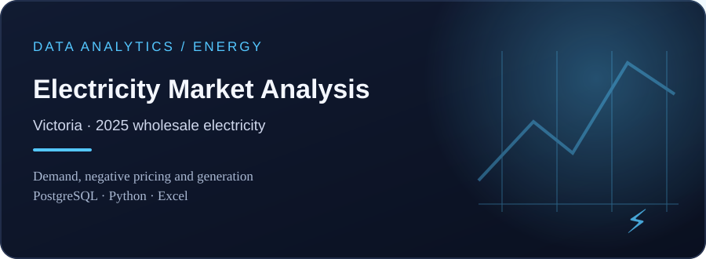
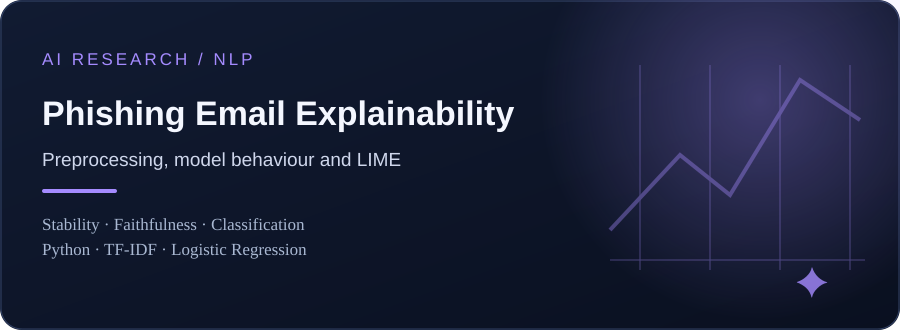
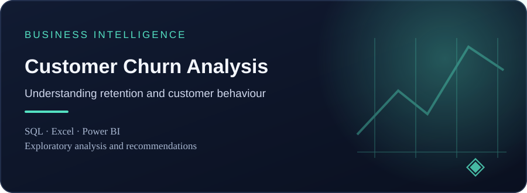

### Data Analytics Graduate &nbsp; • &nbsp; Master's in IT &nbsp; • &nbsp; Aspiring AI Researcher

📍 Melbourne, Australia &nbsp; | &nbsp; Curious about data and how AI works

---

## 👋 A little about me

I'm interested in **finding meaningful patterns in data** and understanding **why machine-learning models behave as they do**. I build end-to-end analytics projects, practise Python and SQL, and explore **explainable AI (XAI)** through research.

- 🔬 **Research:** How text preprocessing affects phishing-email classification and LIME explanation stability and faithfulness
- ⚡ **Data project:** Victorian electricity demand, generation and negative wholesale prices
- 📚 **Currently learning:** Python, PostgreSQL, machine learning and research methods
- 🎯 **Long-term direction:** Industry analytics and AI research

## 🛠️ My toolkit

## 🚀 Featured projects

<table>
<tr>
<td width="50%"> <b>AEMO VIC Electricity Market</b> Demand, negative wholesale prices and generation patterns.</td>
<td width="50%"> <b>Phishing Email Explainability</b> Preprocessing, model classification and explanation quality.</td>
</tr>
<tr>
<td width="50%"> <b>Telco Customer Churn</b> Retention insights and business recommendations.</td>
<td width="50%"> <b>Retail Sales Analytics</b> Sales, profitability and dimensional modelling.</td>
</tr>
</table>

> 📂 [Browse all repositories](https://github.com/Anush72?tab=repositories). Project cards are visual summaries; add verified direct repository links when available.

## 📈 My GitHub journey

Stats use a third-party service and may be temporarily unavailable. Repository language distribution is not a measure of proficiency.

## 🧭 Where I'm heading

**Learn fundamentals** → **Build practical projects** → **Develop research skills** → **Contribute to trustworthy AI**

---

*Thanks for exploring my work.*

[GitHub](https://github.com/Anush72) · [Repositories](https://github.com/Anush72?tab=repositories)

